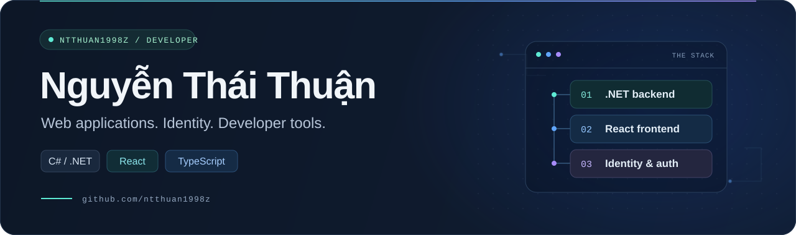
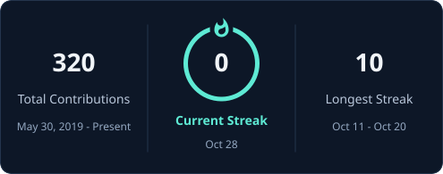

<p align="center">
  
</p>

<p align="center">
  <a href="https://github.com/ntthuan1998z?tab=repositories"><strong>Explore my repositories</strong></a>
  &nbsp; · &nbsp;
  <a href="https://github.com/ntthuan1998z/ntthuan1998z/blob/main/dev-notes.md">Developer notes</a>
</p>

### Hi, I'm Thuận

I build web applications with **C# / .NET** and **React / TypeScript**. My projects explore authentication, web interfaces, and tools that make development easier.

## Technology Stack

<p>
  
  
  
  
  
</p>

<p>
  
  
  
  
</p>

<p>
  
  
  
  
</p>

## Engineering Principles

```text
Build useful software and keep improving it.

Keep designs simple and responsibilities clear.
Choose readable code and maintainable abstractions.
Deliver changes in small, reviewable steps.
Automate repetitive work and document what matters.
```

## GitHub Activity

<p align="center">
  <a href="https://github.com/ntthuan1998z?tab=overview"></a>
  <a href="https://github.com/ntthuan1998z?tab=overview"></a>
</p>

<p align="center">
  <picture>
    <source media="(prefers-color-scheme: dark)" srcset="./assets/github-snake-dark.svg" />
    <source media="(prefers-color-scheme: light)" srcset="./assets/github-snake.svg" />
    
  </picture>
</p>

<p align="center"><sub>Public GitHub activity · Updated daily</sub></p>

## Selected Projects

| Project | What you'll find | Stack |
| :--- | :--- | :--- |
| **[Auther](https://github.com/ntthuan1998z/Auther)** | An identity server with a UI, built around OpenID Connect and OpenIddict. | C# · .NET |
| **[gippi-portal](https://github.com/ntthuan1998z/gippi-portal)** | A React web portal with TypeScript, Vite, and reusable UI components. | React · TypeScript · Tailwind CSS |
| **[FindReferences](https://github.com/ntthuan1998z/FindReferences)** | A utility for inspecting .NET project references and exporting dependency information. | C# |

## Notes & Experiments

I also keep practical references and snippets here:

- **[Developer notes](https://github.com/ntthuan1998z/ntthuan1998z/blob/main/dev-notes.md)** — Git, ASP.NET Core, dependency injection, SQL, and authentication references.
- **[Deployment notes](https://github.com/ntthuan1998z/ntthuan1998z/blob/main/deploy.md)** — .NET on Ubuntu, Docker, and server setup.

---

<p align="center">
  <sub>Thanks for stopping by. Take a look around and explore what I'm building.</sub>
</p>
